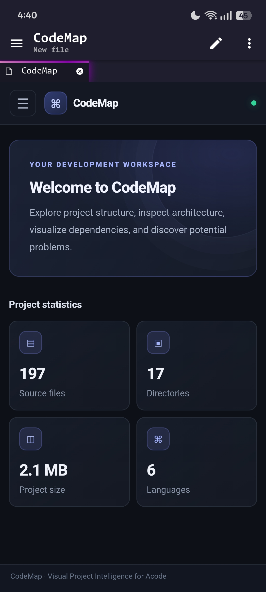
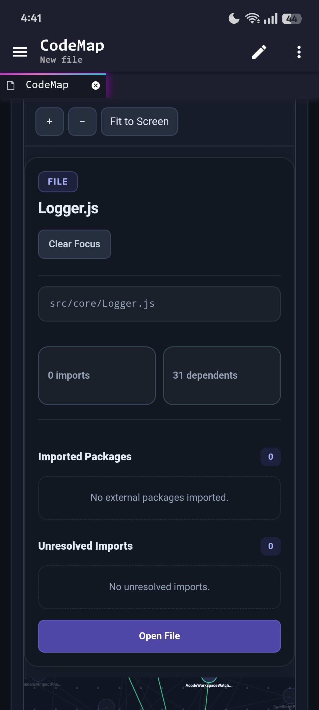
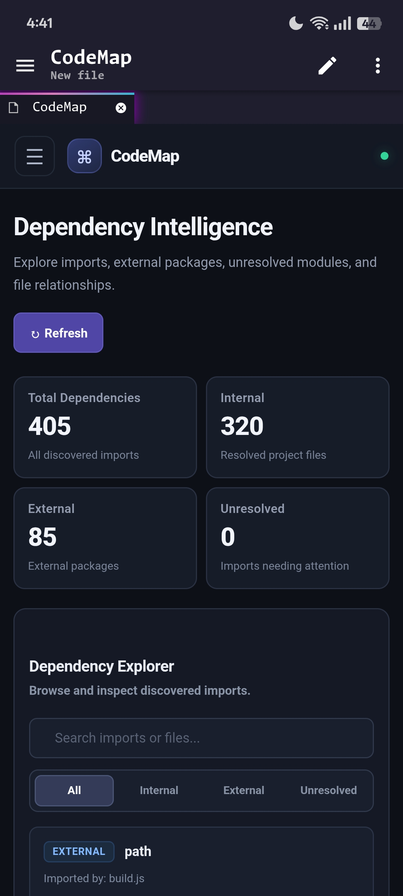
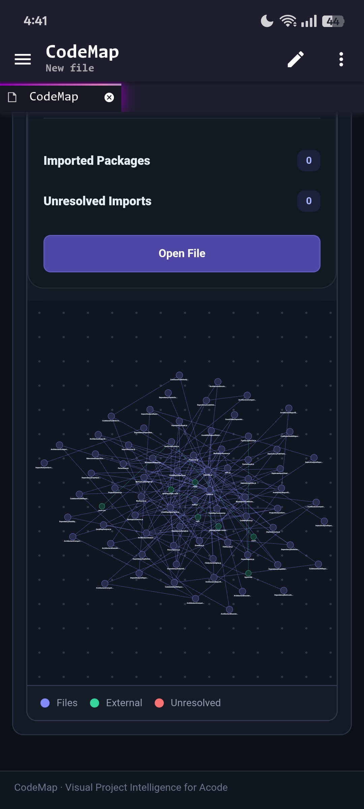
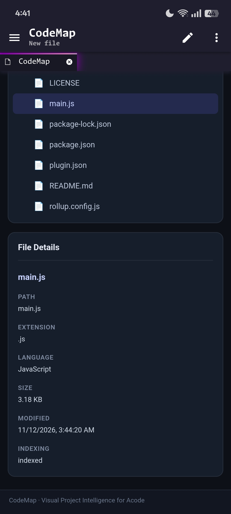
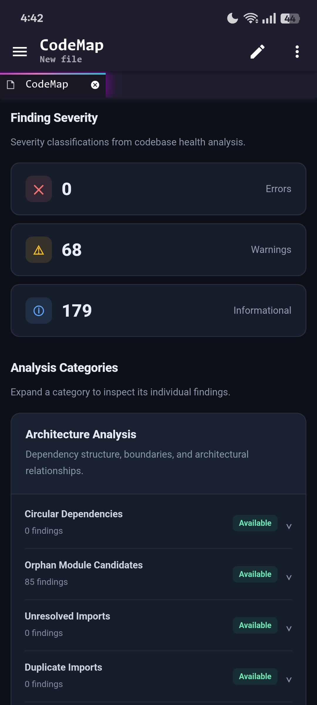
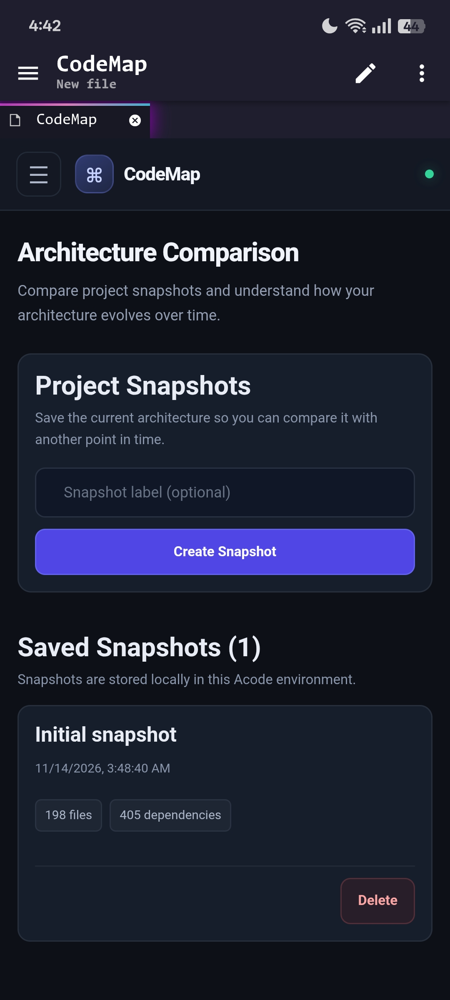
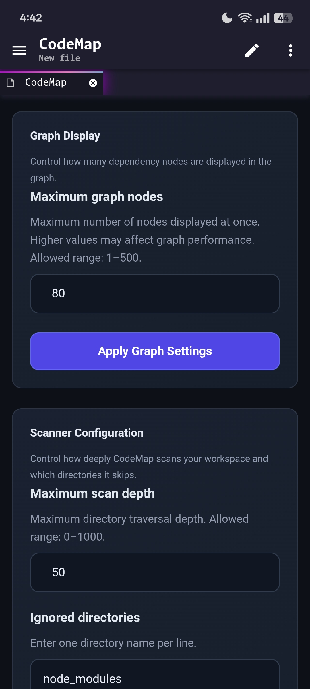

# CodeMap

### Visual Project Intelligence for Acode

Understand your codebase. Explore dependencies. Analyze architecture. Track structural changes.

---

## Overview

**CodeMap** is a project intelligence plugin for [Acode](https://acode.app/) designed to help developers understand, explore, and analyze their codebases visually.

Instead of manually navigating files and tracing imports, CodeMap brings project structure, dependency relationships, architecture insights, and codebase health information into one interface.

Whether you're exploring an unfamiliar project or maintaining a large codebase, CodeMap helps you understand how everything connects.

## Screenshots

Explore the CodeMap interface.

### Overview

Get a quick summary of your project and its structure.

### Dependency Analysis

Understand how files and modules connect through imports and dependencies.

### Dependency Overview

Explore dependency statistics and relationships across your project.

### Dependency Graph

Visualize relationships between project files through an interactive dependency graph.

### File Details

Inspect individual files and their dependency information.

### Architecture Analysis

Analyze project architecture, structural boundaries, dependencies, and codebase health.

### Snapshot Comparison

Compare architecture snapshots to understand structural changes over time.

### Settings

Configure scanner behavior and graph display options.

---

## Features

### 1. Workspace Management

Manage and explore your project workspace.

- Open project folders through Acode.
- Automatically scan and index workspace files.
- Detect project structure and directories.
- Track workspace changes.
- Monitor scanning and indexing status.
- Refresh workspace information when changes occur.

### 2. Project Explorer

Explore your project structure through a dedicated interface.

- Browse indexed files and folders.
- Navigate project contents.
- Inspect individual file information.
- Open workspace files directly in Acode.
- Access dependency information from file details.

### 3. Dependency Analysis

Understand relationships between modules and files.

- Analyze import and export relationships.
- Generate dependency graphs.
- Identify internal dependencies.
- Track external dependencies.
- Detect unresolved imports.
- Explore dependency paths.
- Inspect dependency relationships.
- Configure graph node limits.

### 4. Dependency Graph Visualization

Visualize the structure of your project's dependency network.

- Explore connected files and modules.
- Identify dependency relationships.
- Understand how modules connect.
- Inspect graph nodes and their details.
- Navigate complex dependency structures.

### 5. Architecture Analysis

Gain deeper insights into your project's architecture.

CodeMap includes several architecture analysis tools:

- **Architecture Structure Detection** – identify structural organization within a project.
- **Architecture Boundary Analysis** – inspect architectural boundaries and potential violations.
- **Boundary Rules** – generate and manage architecture boundary rules.
- **Cross-Folder Dependencies** – understand relationships across project directories.
- **Dependency Cycle Detection** – identify circular dependency relationships.
- **Dependency Clustering** – identify groups of closely connected modules.
- **Dependency Depth Analysis** – inspect dependency depth.
- **Coupling Analysis** – examine relationships and coupling between modules.
- **Dependency Stability Analysis** – evaluate dependency stability.
- **Dependency Bottleneck Analysis** – identify important dependency bottlenecks.
- **Impact Analysis** – investigate potential effects of changes across the project.

### 6. Codebase Health Analysis

Inspect potential structural and dependency problems.

- Detect duplicate imports.
- Identify orphaned files.
- Find unresolved imports.
- Analyze dependency-related issues.
- Generate codebase health reports.
- Export analysis reports.

### 7. Snapshot Management

Capture and compare your project's architecture.

- Create architecture snapshots.
- Store snapshots locally.
- Compare different project snapshots.
- Identify structural changes.
- Generate architecture comparison reports.
- Export comparison results.

Snapshots help you understand how your project's architecture evolves as development continues.

### 8. Reporting and Exporting

CodeMap provides report generation for supported analysis features.

- Architecture reports.
- Codebase health reports.
- Impact analysis reports.
- Architecture comparison reports.

### 9. Settings and Customization

Configure CodeMap according to your project.

- Adjust workspace scanner settings.
- Configure dependency graph display limits.
- View dependency node statistics.
- Monitor indexed project information.

---

## Supported Languages

CodeMap currently includes parser support for:

- JavaScript
- TypeScript

Import resolution and analysis capabilities depend on the supported parser and resolver implementations.

Additional language support may be introduced in future updates.

## Installation

1. Open Acode.
2. Install CodeMap from the Acode plugin marketplace.
3. Open the project you want to analyze.

## Usage

1. Open the Command Palette using "Ctrl + Shift + P".
2. Search for "Open CodeMap project intelligence".
3. Select the command to launch CodeMap.
4. Wait for the workspace to be scanned and indexed.
5. Use the navigation panel to explore the available features.

## Main Sections

- Overview — View workspace information and project statistics.
- Explorer — Browse project files and inspect their details.
- Dependencies — Explore imports, exports, and relationships between files.
- Analysis — Review architecture, dependency health, and codebase insights.
- Compare — Compare project snapshots and identify structural changes.
- Settings — Customize CodeMap's available options.

CodeMap automatically analyzes the opened workspace. For the best results, open the project folder in Acode before launching the command.

### Getting Started

1. Launch CodeMap.
2. Open your desired project workspace.
3. Wait for workspace scanning and indexing to finish.
4. Explore the Overview dashboard.
5. Open the Explorer to browse project files.
6. Visit Dependencies to inspect module relationships.
7. Use Analysis to inspect architecture and codebase health.
8. Create architecture snapshots to track structural changes.
9. Use Compare to examine differences between snapshots.

## Project Structure

CodeMap is organized into modular components:

| Directory | Responsibility |
|---|---|
| `src/analysis/` | Architecture, dependency, impact, and health analysis |
| `src/core/` | Core utilities, events, constants, and error handling |
| `src/dependency/` | Dependency graph and query management |
| `src/parser/` | Language parsing and parser services |
| `src/resolver/` | Import and module resolution |
| `src/snapshot/` | Architecture snapshots and storage |
| `src/workspace/` | Workspace scanning, indexing, and management |
| `src/ui/` | User interface, views, components, and styles |

## Technology

CodeMap is built using JavaScript and integrates with Acode's plugin environment.

Its modular architecture separates:

- Workspace management
- Parsing and import resolution
- Dependency analysis
- Architecture analysis
- Snapshot management
- User interface components

## Roadmap

Potential future improvements include:

- Additional programming language support.
- More advanced architecture insights.
- Improved analysis and visualization.
- Additional codebase health checks.
- Performance improvements for larger workspaces.
- Further UI and usability refinements.

## License

CodeMap is **proprietary software**.

Copyright (c) 2026 Zylle Mojica. All rights reserved.

Unauthorized copying, modification, redistribution, resale, or reuse is prohibited unless explicitly permitted by the copyright owner.

Read the full license terms in the [LICENSE file](https://github.com/Ryze282747/CodeMap-Showcase/blob/main/LICENSE).

## Author & Contact

**Zylle Mojica**

- GitHub: [@Ryze282747](https://github.com/Ryze282747)
- Showcase: [CodeMap-Showcase](https://github.com/Ryze282747/CodeMap-Showcase)
- Email: [zyllemojica0123@gmail.com](mailto:zyllemojica0123@gmail.com)
- Instagram: [@ryzexlsv](https://www.instagram.com/ryzexlsv/)

For questions, feedback, licensing permissions, or business inquiries, feel free to reach out.

---

# CodeMap

**Visual Project Intelligence for Acode**

Designed and developed by Zylle.

[GitHub](https://github.com/Ryze282747) · [Instagram](https://www.instagram.com/ryzexlsv/) · [Email](mailto:zyllemojica0123@gmail.com)

